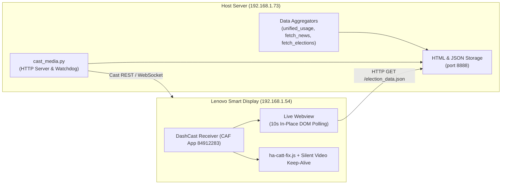

# Smart Display Reporting Hub

A broadcast-grade reporting and live casting hub designed for the **Lenovo Smart Display 10** (Chromecast / Google Cast CAF receiver) and local workstations.

Provides automated multi-view dashboards for real-time portfolio tracking, AI compute usage, breaking financial news, and national election night coverage.

---

## Table of Contents

- [Overview & Display Architecture](#overview--display-architecture)
- [Dashboards](#dashboards)
  - [1. Daily Operations Dashboard](#1-daily-operations-dashboard)
  - [2. Breaking News Dashboard](#2-breaking-news-dashboard)
  - [3. Election Night Decision Desk](#3-election-night-decision-desk)
- [Key Mechanisms & Hardening](#key-mechanisms--hardening)
  - [Chromecast DNS & Direct LAN Casting](#chromecast-dns--direct-lan-casting)
  - [Keep-Alive & Sleep Timeout Bypass](#keep-alive--sleep-timeout-bypass)
  - [Seamless In-Place DOM Updates](#seamless-in-place-dom-updates)
  - [Bedtime Auto-Stop & Election Mode Safeguard](#bedtime-auto-stop--election-mode-safeguard)
- [Command Reference](#command-reference)
- [Repository Structure](#repository-structure)

---

## Overview & Display Architecture

The system uses [DashCast](https://github.com/eslavnov/pydashcast) (`app_id: 84912283`) driven by [`pychromecast`](https://github.com/home-assistant-libs/pychromecast) to stream responsive web dashboards directly to Google Cast smart displays.



---

## Dashboards

### 1. Daily Operations Dashboard
* **Launch**: `./start_dashboard.sh` (or with video: `./start_dashboard.sh --video`)
* **Stop**: `./stop_dashboard.sh`
* **Schedule**: Automated weekdays at 07:00 ET via Dagu.
* **Layout**:
  * **Left Pane (55% ratio)**: Live Multi-Account Trading Monitor (`https://dashboard.luna-strategy.com/account_status.html`) tracking live equity, cash, buying power, and open positions.
  * **Right Pane (45% ratio)**: AI Quotas & Unified Usage Report (`output/usage_report.html`) generated every 60s by `unified_usage.py`, tracking Claude and Gemini rate limits and resets.
  * **Optional Video Pane**: Bloomberg TV live stream in the bottom-right corner when launched with `--video` / `-v`.

### 2. Breaking News Dashboard
* **Launch**: `./start_news.sh`
* **Stop**: `./stop_news.sh`
* **Schedule**: Weekdays at 17:00 ET and weekends at 07:00 ET.
* **Features**:
  * Real-time financial indices strip (S&P 500, Dow, Nasdaq, 10Y Yield, DXY, Bitcoin, WTI Crude).
  * High-priority wire stories and geopolitical dispatches from AP, Reuters, Bloomberg, and CNBC.
  * Seamless auto-scrolling news track with breaking news banner.

### 3. Election Night Decision Desk
* **Launch (Standalone Background)**: `./start_election.sh`
* **Launch under PM2**:
  ```bash
  # Background data monitoring & HTML aggregation (every 45s)
  pm2 start monitor_election.sh --name "election-monitor"

  # Or with integrated Smart Display casting:
  pm2 start monitor_election.sh --name "election-monitor" -- --cast
  ```
* **Stop**: `./stop_election.sh` (or `pm2 stop election-monitor`)
* **Features**:
  * **Official Decision Desk Feed**: Live integration with national results APIs (NBC News Firecracker v2 endpoints) covering Senate, House, and Gubernatorial races.
  * **Balance of Power Board**: Dynamic seat meters showing called seats, majority thresholds (51 Senate / 218 House), seats remaining in play, and net chamber flips.
  * **Battleground Tracker**: Live reporting percentages, vote shares, candidate margins, and projection badges across 50 competitive Senate, Governor, and House districts.
  * **Real-Time Poll Closings Clock**: Poll closing timeline with countdown badges for upcoming state waves.
  * **Financial Market Indicators**: Live market sentiment quotes updated alongside vote counts.
  * **Bottom Wire Marquee**: Continuously scrolling ticker for instant race projections and breaking developments.
  * **Manual Override Capability**: Supports `election_override.json` for simulating or manually overriding specific race calls.

---

## Key Mechanisms & Hardening

### Chromecast DNS & Direct LAN Casting
* **Issue**: Google Cast hardware (including Lenovo Smart Displays) ignores local DHCP DNS servers and hardcodes lookups to `8.8.8.8` / `8.8.4.4`. Internal or VPN-only domain names fail to resolve, causing the display to abort to the ambient Google Backdrop screensaver.
* **Solution**: The dashboard casts using direct local IP binding (`http://192.168.1.73:8888/...`). The display communicates directly across the local LAN subnet (`192.168.1.x`) with zero external DNS dependencies.

### Keep-Alive & Sleep Timeout Bypass
* **Issue**: Chromecast OS enforces a 10-minute idle sleep timeout on custom web views if media is not actively playing.
* **Solution**:
  1. **CAF Receiver Fix** ([`ha-catt-fix.js`](file:///home/backtest01/reporting/ha-catt-fix.js)): Hooks into the Cast Application Framework (`disableIdleTimeout = true`) and sends periodic keep-alive heartbeats to Google's cast framework.
  2. **Silent Loop Video**: Embeds an invisible 1x1 looping silent video element (`ForBiggerBlazes.mp4`) as an absolute media playback keep-alive.

### Seamless In-Place DOM Updates
* **Elimination of Cast Restarts**: Previous iterations restarted the cast session every 9 minutes to refresh data, causing black screens and audio disconnects.
* **Current Solution**: The dashboard stays connected permanently. An in-page JavaScript engine polls `election_data.json` every 10 seconds and updates all seat counts, progress bars, and vote margins in place via DOM manipulation without page reloads. A lightweight background refresh occurs every 10 minutes to prevent Chromium webview memory leaks.

### Bedtime Auto-Stop & Election Mode Safeguard
* **Standard Routine**: Dagu executes `stop_dashboard.sh` at 22:00 ET nightly to power down displays for bedtime.
* **Election Safeguard**: Running `./start_election.sh` sets an `.election_mode` flag. When active, `stop_dashboard.sh` skips termination, allowing overnight election broadcasts to continue uninterrupted. Stopping via `./stop_election.sh` or passing `--force` cleanly removes the flag and shuts down the display.

---

## Command Reference

| Action | Command | Notes |
| :--- | :--- | :--- |
| **Start Daily Dashboard** | `./start_dashboard.sh` | Account Monitor (55%) + AI Usage (45%) |
| **Start Daily Dashboard (w/ Video)** | `./start_dashboard.sh --video` | Includes Bloomberg TV bottom-right |
| **Start News Dashboard** | `./start_news.sh` | Financial & global news ticker |
| **Start Election Dashboard** | `./start_election.sh` | Real-time Decision Desk & BOP board |
| **Monitor Election (PM2)** | `pm2 start monitor_election.sh --name "election-monitor"` | Foreground daemon for PM2 management |
| **Stop All / Reset Display** | `./stop_dashboard.sh --force` | Returns display to ambient Backdrop |
| **Stop Election Mode** | `./stop_election.sh` | Clears `.election_mode` and quits cast |
| **Interactive Video Streamer** | `./pick_video.sh` | Select from curated live news M3U8 streams |
| **Cast Direct Video Stream** | `./play_video.sh [URL]` | Defaults to Bloomberg TV |
| **Regenerate Usage Report** | `./unified_usage.py` | Updates `output/usage_report.html` |
| **One-Time Election Aggregation** | `./venv/bin/python3 fetch_elections.py` | Writes `output/election_data.json` |

---

## Repository Structure

```
reporting/
├── start_dashboard.sh          # Daily dashboard launcher (setsid background service)
├── start_news.sh               # News dashboard launcher
├── start_election.sh           # Election dashboard launcher
├── monitor_election.sh         # PM2 entrypoint wrapper for election monitoring
├── monitor_election.py         # PM2 foreground election monitor daemon & supervisor
├── stop_dashboard.sh           # Master teardown script (kills cast, proxies, and loops)
├── stop_election.sh            # Symlink to stop_dashboard.sh
├── stop_news.sh                # Symlink to stop_dashboard.sh
│
├── cast_media.py               # Chromecast streaming server, split-screen engine, & watchdog
├── ha-catt-fix.js              # CAF receiver keep-alive script for DashCast
├── unified_usage.py            # AI usage scraper (Claude Code, Gemini CLI, Cloudflare)
├── fetch_news.py               # Multi-source RSS & Yahoo Finance news aggregator
├── fetch_elections.py          # Real-time Decision Desk aggregator & BOP calculator
│
├── logs/                       # Log directory for daemons and reverse proxy
│   ├── caddy.log               # Caddy reverse proxy log
│   ├── cast_media.log          # Chromecast streaming and watchdog log
│   ├── election.log            # Background election fetcher log
│   └── news.log                # Background news fetcher log
│
├── output/                     # Generated reports, dashboards, and live data
│   ├── election_dashboard.html # Broadcast-grade election big board template
│   ├── election_data.json      # Live election state payload (polled every 10s by DOM)
│   ├── news_dashboard.html     # Financial news dashboard template
│   ├── news_data.json          # Live financial & world news headlines payload
│   └── usage_report.html       # Generated AI quota summary table
├── outputs                     # Symlink pointing to output/
│
├── election_override.json.example # Template for simulating or overriding race calls
├── pick_video.sh               # Interactive live news stream selector
├── play_video.sh               # Direct full-screen video cast script
├── Caddyfile                   # Optional HTTPS reverse proxy config
└── setup.sh                    # Initial venv setup and dependency installer
```
